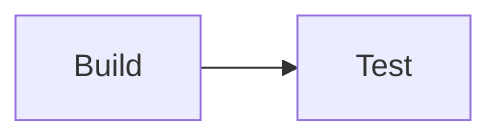

Callout body.

Admonition body.


  Left.
  Right.



  {}First tab.{}
  {}Second tab.{}


Hidden detail.


print("hello")





Copy: fixture@example.com


\begin{algorithm}
\caption{Fixture}
\begin{algorithmic}
\RETURN true
\end{algorithmic}
\end{algorithm}


Button

A minimal quote.



















```markmap
# Fixture
## Shortcodes
- all
```









Rating: 
